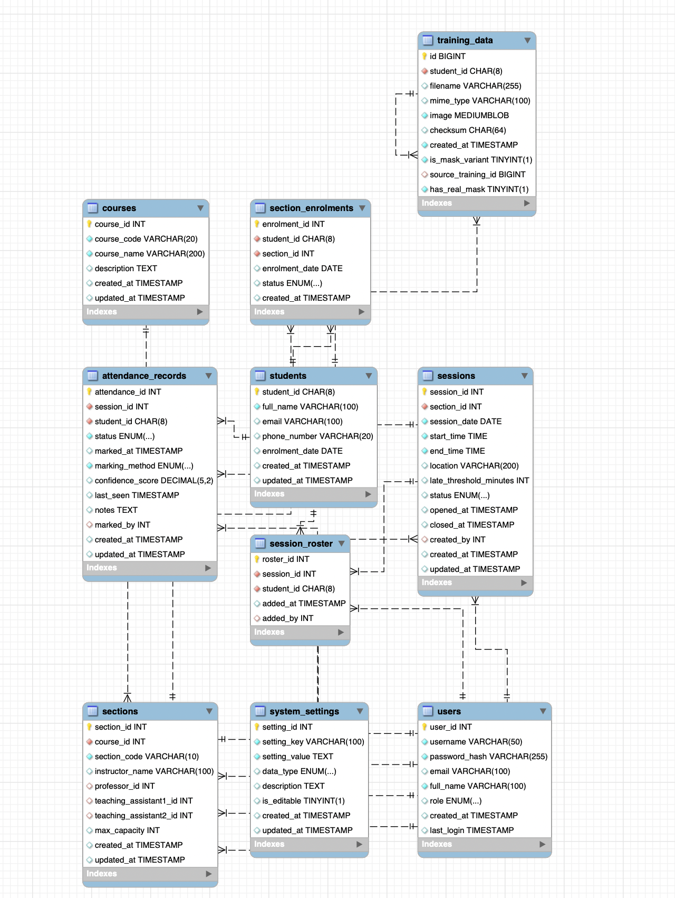

# Smart Attendance System - Database Documentation

## Overview

The Smart Attendance System database is designed to support a face recognition-based attendance tracking application built using MySQL 8.x. The system automates attendance marking through computer vision whilst supporting manual overrides. It is optimised for SMU, managing multiple courses, sections, sessions, and student enrolments.

## Database Configuration

### Character Set and Collation

- **Database Name**: `smart_attendance_system`
- **Character Set**: `utf8mb4`
- **Collation**: `utf8mb4_unicode_ci`
- **Storage Engine**: InnoDB (for all tables)

## Usage Guidelines

### Initial Setup

1. Launch **MAMP/WAMP** on your machine
2. Go to **MySQL Workbench**
3. Execute the SQL schema file to create database and objects
4. Create initial ADMIN user in users table with hashed password.  
5. Configure system_settings for recognition threshold and log paths
6. Set up courses and sections structure

## Database Schema

### Entity Relationship Model

The database consists of 10 core tables organised into the following functional domains:

1. **User Management**: Users
2. **Academic Structure**: Courses, Sections
3. **Student Management**: Students, Section Enrolments
4. **Attendance Operations**: Sessions, Session Roster, Attendance Records
5. **Face Recognition**: Training Data
6. **System Configuration**: System Settings

### Table Definitions

#### 1. Students

The `students` table stores core student profile information.

**Purpose**: Central repository for student demographic and contact details.

| Column | Data Type | Constraints | Description |
| :-- | :-- | :-- | :-- |
| `student_id` | CHAR(8) | PRIMARY KEY | Unique 8-character student identifier starting with 0 |
| `full_name` | VARCHAR(100) | NOT NULL | Student's full name |
| `email` | VARCHAR(100) | NULL | Student email address |
| `phone_number` | VARCHAR(20) | NULL | Contact telephone number |
| `enrolment_date` | DATE | DEFAULT CURDATE() | Date of student enrolment |
| `created_at` | TIMESTAMP | DEFAULT CURRENT_TIMESTAMP | Record creation timestamp |
| `updated_at` | TIMESTAMP | DEFAULT CURRENT_TIMESTAMP ON UPDATE | Last modification timestamp |

**Indexes**:

- `idx_student_email`: Optimises email-based lookups
- `idx_student_phone`: Accelerates phone number searches

**Business Rules**:

- Student ID must be exactly 8 characters and start with 0 
- Enrolment date automatically defaults to current date if not specified

#### 2. Users

The `users` table manages system authentication and authorisation for administrators, professors, and teaching assistants.

**Purpose**: Stores user credentials and role-based access control information.

| Column | Data Type | Constraints | Description |
| :-- | :-- | :-- | :-- |
| `user_id` | INT | PRIMARY KEY, AUTO_INCREMENT | Unique user identifier |
| `username` | VARCHAR(50) | NOT NULL, UNIQUE | Login username |
| `password_hash` | VARCHAR(255) | NOT NULL | Bcrypt-hashed password |
| `email` | VARCHAR(100) | UNIQUE | User email address |
| `full_name` | VARCHAR(100) | NOT NULL | User's full name |
| `role` | ENUM | DEFAULT 'ADMIN' | User role: ADMIN, PROFESSOR, TEACHING_ASSISTANT |
| `created_at` | TIMESTAMP | DEFAULT CURRENT_TIMESTAMP | Account creation timestamp |
| `last_login` | TIMESTAMP | NULL | Last successful login timestamp |

**Indexes**:

- `uk_username`: Enforces unique username constraint
- `uk_user_email`: Ensures email uniqueness
- `idx_username`: Optimises login queries
- `idx_user_email`: Accelerates email-based searches

**Security Considerations**:

- Passwords must be stored as hashed values using bcrypt or equivalent
- The system supports multiple professors and teaching assistants with role-based access
- Username and email must be unique across all users

#### 3. Courses

The `courses` table defines academic courses or modules offered by the institution.

**Purpose**: Stores course catalogue information.

| Column | Data Type | Constraints | Description |
| :-- | :-- | :-- | :-- |
| `course_id` | INT | PRIMARY KEY, AUTO_INCREMENT | Unique course identifier |
| `course_code` | VARCHAR(20) | NOT NULL, UNIQUE | Course code (e.g., CS102, IS111) |
| `course_name` | VARCHAR(200) | NOT NULL | Full course name |
| `description` | TEXT | NULL | Course description |
| `created_at` | TIMESTAMP | DEFAULT CURRENT_TIMESTAMP | Record creation timestamp |
| `updated_at` | TIMESTAMP | DEFAULT CURRENT_TIMESTAMP ON UPDATE | Last modification timestamp |

**Indexes**:

- `uk_course_code`: Ensures course codes are unique
- `idx_course_code`: Optimises course code lookups

**Business Rules**:

- Course codes must be unique (e.g., CS102)
- The description field is optional and can contain detailed course information

#### 4. Sections

The `sections` table represents specific class groups or tutorial sections within a course.

**Purpose**: Links courses to instructional staff and manages section-specific metadata.

| Column | Data Type | Constraints | Description |
| :-- | :-- | :-- | :-- |
| `section_id` | INT | PRIMARY KEY, AUTO_INCREMENT | Unique section identifier |
| `course_id` | INT | NOT NULL, FOREIGN KEY | Reference to parent course |
| `section_code` | VARCHAR(10) | NOT NULL | Section identifier (e.g., G1, G2) |
| `instructor_name` | VARCHAR(100) | NULL | Instructor name field |
| `professor_id` | INT | FOREIGN KEY | Assigned professor for the section |
| `teaching_assistant1_id` | INT | FOREIGN KEY | Primary teaching assistant |
| `teaching_assistant2_id` | INT | FOREIGN KEY | Secondary teaching assistant |
| `max_capacity` | INT | DEFAULT 50 | Maximum student enrolment capacity |
| `created_at` | TIMESTAMP | DEFAULT CURRENT_TIMESTAMP | Record creation timestamp |
| `updated_at` | TIMESTAMP | DEFAULT CURRENT_TIMESTAMP ON UPDATE | Last modification timestamp |

**Indexes**:

- `uk_course_section`: Composite unique key on (course_id, section_code)
- `idx_section_code`: Optimises section code searches
- `idx_section_course`: Accelerates course-based queries
- `idx_section_professor`, `idx_section_ta1`, `idx_section_ta2`: Support staff assignment queries

**Foreign Key Relationships**:

- `fk_sections_course`: CASCADE on delete/update (deleting a course removes all sections)
- `fk_sections_professor`, `fk_sections_ta1`, `fk_sections_ta2`: SET NULL on delete (staff removal doesn't delete section)

**Business Rules**:

- Each course-section combination must be unique
- Supports up to two teaching assistants per section
- Default maximum capacity is 50 students
- The system can accommodate multiple professors and teaching assistants

#### 5. Sessions

The `sessions` table represents individual class occurrences or lecture sessions.

**Purpose**: Manages attendance-taking events with status tracking.

| Column | Data Type | Constraints | Description |
| :-- | :-- | :-- | :-- |
| `session_id` | INT | PRIMARY KEY, AUTO_INCREMENT | Unique session identifier |
| `section_id` | INT | NOT NULL, FOREIGN KEY | Reference to parent section |
| `session_date` | DATE | NOT NULL | Date of the session |
| `start_time` | TIME | NOT NULL | Session start time |
| `end_time` | TIME | NOT NULL | Session end time |
| `location` | VARCHAR(200) | NULL | Classroom or venue |
| `late_threshold_minutes` | INT | DEFAULT 15 | Minutes after start time to mark as late |
| `status` | ENUM | DEFAULT 'PENDING' | PENDING, OPEN, CLOSED |
| `opened_at` | TIMESTAMP | NULL | Timestamp when session was opened |
| `closed_at` | TIMESTAMP | NULL | Timestamp when session was closed |
| `created_by` | INT | FOREIGN KEY | User who created the session |
| `created_at` | TIMESTAMP | DEFAULT CURRENT_TIMESTAMP | Record creation timestamp |
| `updated_at` | TIMESTAMP | DEFAULT CURRENT_TIMESTAMP ON UPDATE | Last modification timestamp |

**Indexes**:

- `idx_section`: Optimises section-based queries
- `idx_session_date`: Accelerates date-based searches
- `idx_status`: Supports status filtering
- `idx_section_date`: Composite index for section-date combinations
- `idx_section_date_status`: Optimises complex queries involving all three fields

**Foreign Key Relationships**:

- `fk_sessions_section`: CASCADE on delete/update
- `fk_sessions_created_by`: SET NULL on delete

**Session Lifecycle**:

1. **PENDING**: Session created but not yet started
2. **OPEN**: Recognition window active, attendance marking in progress, late threshold enforced
3. **CLOSED**: Recognition stopped, attendance finalised, edits locked (except instructor overrides)

**Business Rules**:

- Opening a session enables late threshold enforcement
- Default late threshold is 15 minutes after start time
- Closing a session prevents spoofing and finalises the roster

#### 6. Attendance Records

The `attendance_records` table captures individual student attendance entries for each session.

**Purpose**: Records attendance status 

| Column | Data Type | Constraints | Description |
| :-- | :-- | :-- | :-- |
| `attendance_id` | INT | PRIMARY KEY, AUTO_INCREMENT | Unique attendance record identifier |
| `session_id` | INT | NOT NULL, FOREIGN KEY | Reference to session |
| `student_id` | CHAR(8) | NOT NULL, FOREIGN KEY | Reference to student |
| `status` | ENUM | NOT NULL | PRESENT, ABSENT, LATE |
| `marked_at` | TIMESTAMP | DEFAULT CURRENT_TIMESTAMP | When attendance was marked |
| `marking_method` | ENUM | NOT NULL | AUTO (face recognition) or MANUAL |
| `confidence_score` | DECIMAL(5,2) | NULL | Recognition confidence (0-100) for AUTO method |
| `last_seen` | TIMESTAMP | NULL | Last detection timestamp for cooldown management |
| `notes` | TEXT | NULL | Optional notes (e.g., Medical Leave, Student is late) |
| `marked_by` | INT | FOREIGN KEY | User who manually marked (NULL for AUTO) |
| `created_at` | TIMESTAMP | DEFAULT CURRENT_TIMESTAMP | Record creation timestamp |
| `updated_at` | TIMESTAMP | DEFAULT CURRENT_TIMESTAMP ON UPDATE | Last modification timestamp |

**Indexes**:

- `uk_session_student_attendance`: Composite unique key preventing duplicate attendance records
- `idx_attend_session`, `idx_attend_student`: Single-column indexes for efficient queries
- `idx_attend_status`, `idx_attend_method`: Support filtering by status and method
- `idx_attend_marked_at`: Optimises time-based queries
- `idx_attend_session_status`: Composite index for session-status queries
- `idx_attend_marked_by`: Supports user-based audit queries

**Foreign Key Relationships**:

- `fk_attendance_session`: CASCADE on delete/update
- `fk_attendance_student`: CASCADE on delete/update
- `fk_attendance_marked_by`: SET NULL on delete

**Business Rules**:

- Each student can only have one attendance record per session (enforced by unique constraint)
- Confidence score is only applicable for AUTO marking method
- The `last_seen` field supports cooldown timers to prevent duplicate marking
- Manual overrides are tracked via the `marked_by` field
- Notes field supports custom annotations such as "Medical Leave" or "Student is late"

#### 7. Session Roster

The `session_roster` table maintains the expected attendance list for each session.

**Purpose**: Pre-populates sessions with enrolled students and supports  additions.

| Column | Data Type | Constraints | Description |
| :-- | :-- | :-- | :-- |
| `roster_id` | INT | PRIMARY KEY, AUTO_INCREMENT | Unique roster entry identifier |
| `session_id` | INT | NOT NULL, FOREIGN KEY | Reference to session |
| `student_id` | CHAR(8) | NOT NULL, FOREIGN KEY | Reference to student |
| `added_at` | TIMESTAMP | DEFAULT CURRENT_TIMESTAMP | When student was added to roster |
| `added_by` | INT | FOREIGN KEY | User who added student to roster |

**Indexes**:

- `uk_session_student`: Composite unique key preventing duplicate roster entries
- `idx_roster_session`, `idx_roster_student`: Single-column indexes
- `idx_roster_added_by`: Supports audit queries

**Foreign Key Relationships**:

- `fk_roster_session`: CASCADE on delete/update
- `fk_roster_student`: CASCADE on delete/update
- `fk_roster_added_by`: SET NULL on delete

**Business Rules**:

- Rosters can be automatically populated using the `sp_populate_session_roster` stored procedure
- The roster serves as the baseline for marking attendance
- Students can be added to rosters even after session creation
- When a session is closed, students on the roster without attendance records are automatically marked as ABSENT

#### 8. Section Enrolments

The `section_enrolments` table tracks which students are enrolled in which course sections.

**Purpose**: Manages student-section relationships with enrolment status tracking.

| Column | Data Type | Constraints | Description |
| :-- | :-- | :-- | :-- |
| `enrolment_id` | INT | PRIMARY KEY, AUTO_INCREMENT | Unique enrolment record identifier |
| `student_id` | CHAR(8) | NOT NULL, FOREIGN KEY | Reference to student |
| `section_id` | INT | NOT NULL, FOREIGN KEY | Reference to section |
| `enrolment_date` | DATE | DEFAULT CURDATE() | Date of enrolment |
| `status` | ENUM | DEFAULT 'ENROLLED' | ENROLLED, DROPPED, COMPLETED |
| `created_at` | TIMESTAMP | DEFAULT CURRENT_TIMESTAMP | Record creation timestamp |

**Indexes**:

- `uk_unique_enrolment`: Composite unique key on (student_id, section_id)
- `idx_enrol_student`, `idx_enrol_section`: Single-column indexes
- `idx_enrol_status`: Supports status-based filtering

**Foreign Key Relationships**:

- `fk_enrol_student`: CASCADE on delete/update
- `fk_enrol_section`: CASCADE on delete/update

**Business Rules**:

- A student can only be enrolled in a specific section once
- Enrolment status tracks the student's relationship to the section throughout the academic term
- Only students with 'ENROLLED' status are included in session rosters

#### 9. Training Data

The `training_data` table stores facial images used for training the face recognition model.

**Purpose**: Maintains the facial dataset required for student identification with support for mask-variant handling.

| Column | Data Type | Constraints | Description |
| :-- | :-- | :-- | :-- |
| `id` | BIGINT | PRIMARY KEY, AUTO_INCREMENT | Unique training image identifier |
| `student_id` | CHAR(8) | NOT NULL, FOREIGN KEY | Reference to student |
| `filename` | VARCHAR(255) | NULL | Original filename |
| `mime_type` | VARCHAR(100) | NULL | Image MIME type |
| `image` | MEDIUMBLOB | NOT NULL | Binary image data |
| `checksum` | CHAR(64) | NULL | SHA-256 hash for integrity verification |
| `created_at` | TIMESTAMP | DEFAULT CURRENT_TIMESTAMP | Image upload timestamp |
| `is_mask_variant` | TINYINT(1) | DEFAULT 0 | Indicates if image is a mask-augmented variant |
| `source_training_id` | BIGINT | FOREIGN KEY | Reference to original image if mask variant |
| `has_real_mask` | TINYINT(1) | DEFAULT 0 | Indicates if student is wearing actual mask |

**Indexes**:

- `idx_training_student`: Optimises student-based queries
- `idx_training_checksum`: Supports duplicate detection
- `idx_training_source`: Links mask variants to originals

**Foreign Key Relationships**:

- `fk_training_student`: CASCADE on delete/update
- `fk_training_variant_source`: CASCADE on delete (removing original removes variants)

**Business Rules**:

- Images are stored as binary blobs (MEDIUMBLOB supports up to 16MB per image)
- The system supports mask-aware recognition as a bonus feature
- SHA-256 checksums ensure data integrity and prevent duplicate uploads
- Each student should have 10-20 facial images for optimal recognition accuracy
- Images should be preprocessed (greyscale, normalised, resized) before storage

#### 10. System Settings

The `system_settings` table provides configurable parameters for application behaviour.

**Purpose**: Centralised configuration management with type-safe value storage.

| Column | Data Type | Constraints | Description |
| :-- | :-- | :-- | :-- |
| `setting_id` | INT | PRIMARY KEY, AUTO_INCREMENT | Unique setting identifier |
| `setting_key` | VARCHAR(100) | NOT NULL, UNIQUE | Setting key (e.g., recognition_threshold) |
| `setting_value` | TEXT | NOT NULL | Setting value |
| `data_type` | ENUM | DEFAULT 'STRING' | STRING, INTEGER, DECIMAL, BOOLEAN, JSON |
| `description` | TEXT | NULL | Human-readable description |
| `is_editable` | TINYINT(1) | DEFAULT 1 | Prevents modification of critical settings |
| `created_at` | TIMESTAMP | DEFAULT CURRENT_TIMESTAMP | Record creation timestamp |
| `updated_at` | TIMESTAMP | DEFAULT CURRENT_TIMESTAMP ON UPDATE | Last modification timestamp |

**Indexes**:

- `uk_setting_key`: Ensures setting keys are unique
- `idx_setting_key`: Optimises key-based lookups

**Pre-configured Settings**:

- `recognition_threshold`: Minimum confidence score for automatic marking (default: 85.00)
- `attendance_log_path`: File system path for audit logs (default: logs/attendance.log)

**Business Rules**:

- Settings marked as non-editable (`is_editable = 0`) protect critical system parameters
- The `data_type` field enables type-safe configuration management
- Settings support JSON values for complex configuration objects

## Stored Procedures

### sp_close_session

**Purpose**: Safely closes an attendance session and automatically marks absent students.

**Parameters**:

- `p_session_id` (INT): The session to close
- `p_closed_by_user_id` (INT): User performing the closure

**Process Flow**:

1. Validates session exists
2. Verifies session status is 'OPEN'
3. Identifies students on roster without attendance records
4. Automatically creates ABSENT attendance records with marking_method='AUTO'
5. Updates session status to 'CLOSED'
6. Records closure timestamp

**Error Handling**:

- Raises error if session not found
- Raises error if session is not in OPEN status

**Usage Context**: Called when an instructor completes a class session to finalise attendance and prevent further modifications.

### sp_populate_session_roster

**Purpose**: Automatically populates a session roster with currently enrolled students.

**Parameters**:

- `p_session_id` (INT): The session to populate
- `p_added_by_user_id` (INT): User performing the operation

**Process Flow**:

1. Validates session exists
2. Retrieves section_id for the session
3. Queries all students with 'ENROLLED' status in that section
4. Inserts them into session_roster (ignoring duplicates)

**Error Handling**:

- Raises error if session not found

**Business Logic**: Uses `INSERT IGNORE` to safely handle duplicate roster entries, ensuring idempotent execution.

**Usage Context**: Typically called immediately after session creation to establish the expected student list.

## Database Views

### vw_active_students

**Purpose**: Provides a consolidated view of students with their enrolment and facial data statistics.

**Columns**:

- `student_id`: Student identifier
- `full_name`: Student name
- `email`: Contact email
- `enrolled_sections_count`: Number of active section enrolments
- `face_images_count`: Number of training images on file
- `enrolment_date`: Initial enrolment date
- `created_at`: Record creation timestamp

**Use Cases**:

- Student management dashboards
- Identifying students requiring additional facial data
- Enrolment verification queries

**Performance Considerations**: Uses LEFT JOINs to include students even if they have no enrolments or facial data.

### vw_session_attendance_summary

**Purpose**: Generates comprehensive attendance statistics for each session.

**Columns**:

- `session_id`: Session identifier
- `course_code`, `course_name`, `section_code`: Academic context
- `course_section`: Concatenated course-section identifier (e.g., CS102-G1)
- `session_date`, `start_time`, `end_time`, `location`: Session details
- `session_status`: PENDING, OPEN, or CLOSED
- `total_roster`: Total students expected
- `present_count`: Students marked PRESENT
- `late_count`: Students marked LATE
- `absent_count`: Students marked ABSENT
- `pending_count`: Students not yet marked
- `attendance_percentage`: Percentage of students present or late

**Calculation Logic**:

- Attendance percentage = (PRESENT + LATE) / total_roster × 100
- Uses `NULLIF` to prevent division by zero

**Use Cases**:

- Session attendance reports
- Real-time attendance monitoring during sessions
- Course-level attendance analytics

### vw_student_attendance_history

**Purpose**: Provides a comprehensive chronological attendance history for each student.

**Columns**:

- `student_id`, `full_name`: Student identification
- `course_code`, `course_name`, `section_code`, `course_section`: Course context
- `session_date`, `start_time`, `end_time`: Session timing
- `attendance_status`: PRESENT, ABSENT, LATE, or PENDING
- `marking_method`: AUTO or MANUAL
- `confidence_score`: Recognition confidence (if AUTO)
- `marked_at`: Marking timestamp
- `notes`: Optional annotations

**Ordering**: Results are ordered by student_id (ascending), then session_date and start_time (descending).

**Use Cases**:

- Individual student attendance reports
- Academic intervention identification (students with poor attendance)
- Attendance pattern analysis

**Business Logic**: Uses `COALESCE` to display 'PENDING' for students on rosters who haven't been marked.

## Indexing Strategy

### Primary Indexes

All tables employ auto-incrementing integer primary keys (except `students`, which uses a natural 8-character key). This approach ensures:

- Efficient row identification
- Optimal foreign key reference performance
- Simplified join operations

### Secondary Indexes

The schema implements a comprehensive indexing strategy:

**Single-Column Indexes**: Applied to frequently queried columns (e.g., `idx_session_date`, `idx_attend_status`)

**Composite Indexes**: Optimise complex queries involving multiple predicates:

- `idx_section_date_status` on sessions table
- `idx_attend_session_status` on attendance_records table

**Unique Indexes**: Enforce business rules and prevent data anomalies:

- `uk_username` and `uk_user_email` on users table
- `uk_course_code` on courses table
- `uk_session_student_attendance` on attendance_records table

## Referential Integrity

### Foreign Key Relationships

The schema employs comprehensive foreign key constraints to maintain data consistency:

**CASCADE Policies**: Propagate deletions and updates through dependent tables:

- Deleting a course removes all associated sections, sessions, and attendance records
- Deleting a student removes all enrolments, attendance records, and training data

**SET NULL Policies**: Preserve historical data when referenced entities are removed:

- Deleting a user sets `created_by`, `marked_by`, and `added_by` fields to NULL
- Deleting staff members sets professor and teaching assistant references to NULL

### Orphan Prevention

The foreign key constraints prevent orphaned records:

- Attendance records cannot exist without valid sessions and students
- Session rosters cannot reference non-existent sessions or students
- Training data cannot exist for non-existent students

## Data Integrity Constraints

### Enumerated Types

The schema uses ENUM types to enforce valid values for categorical data:

**User Roles**: ADMIN, PROFESSOR, TEACHING_ASSISTANT

**Session Status**: PENDING, OPEN, CLOSED

**Attendance Status**: PRESENT, ABSENT, LATE

**Marking Method**: AUTO, MANUAL

**Enrolment Status**: ENROLLED, DROPPED, COMPLETED

**Setting Data Types**: STRING, INTEGER, DECIMAL, BOOLEAN, JSON

### Unique Constraints

Business rules are enforced through unique constraints:

- Username and email uniqueness in users table
- Course code uniqueness in courses table
- One attendance record per student per session
- One enrolment per student per section
- One roster entry per student per session
- Unique course-section combinations

### Default Values

Sensible defaults reduce data entry burden and prevent null-related issues:

- `enrolment_date`: Defaults to current date
- `late_threshold_minutes`: Defaults to 15 minutes
- `max_capacity`: Defaults to 50 students
- `session status`: Defaults to 'PENDING'
- `enrolment status`: Defaults to 'ENROLLED'
- Timestamps: Automatically populated on creation and update

## Security Considerations

### Authentication

- Passwords stored as hashed values (bcrypt recommended)
- Username and email uniqueness enforced at database level
- Last login timestamp enables security auditing

### Authorisation

Role-based access control through the `users.role` field:

- **ADMIN**: Full system access
- **PROFESSOR**: Section and session management
- **TEACHING_ASSISTANT**: Attendance marking and reporting

### Data Protection

**Sensitive Data Handling**:

- Personal information (email, phone) stored with appropriate length limits
- Binary facial data stored securely in BLOBs
- SHA-256 checksums ensure data hasn't been tampered with

**Access Control**:

- Foreign key constraints prevent unauthorised data access

## Business Logic Implementation

### Attendance Marking Workflow

The database schema supports the following attendance marking workflow:

1. **Session Creation**: Insert into `sessions` table with status='PENDING'
2. **Roster Population**: Execute `sp_populate_session_roster` to add enrolled students
3. **Session Opening**: Update session status to 'OPEN', set `opened_at` timestamp
4. **Attendance Marking**:
    - **Automatic**: Face recognition inserts records with marking_method='AUTO'
    - **Manual**: User interface inserts records with marking_method='MANUAL'
    - Confidence scores recorded for AUTO method
    - Late threshold compared against current time vs. session start_time
5. **Session Closure**: Execute `sp_close_session` to finalise attendance and mark absentees
6. **Reporting**: Query views for attendance summaries and history

### Cooldown Management

The `last_seen` field in `attendance_records` implements cooldown logic:

- Prevents duplicate marking within configurable time window (10-30 seconds)
- Updated rather than creating new records when student detected multiple times
- Helps manage continuous video feed recognition scenarios

### Late Threshold Enforcement

The system determines LATE status based on:

- Session `start_time`
- Session `late_threshold_minutes` (default 15)
- Attendance `marked_at` timestamp
- If marked_at > start_time + late_threshold_minutes, status = 'LATE'

### Confidence Threshold

The `system_settings` table stores recognition_threshold (default 85.00):

- Attendance records with confidence_score below threshold should trigger manual confirmation
- Application logic should implement confidence-based workflows using this setting

